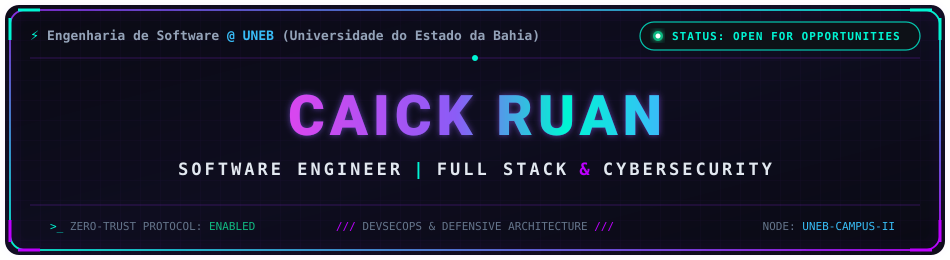
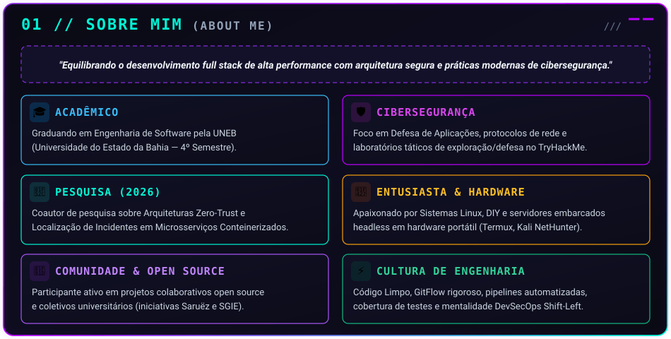
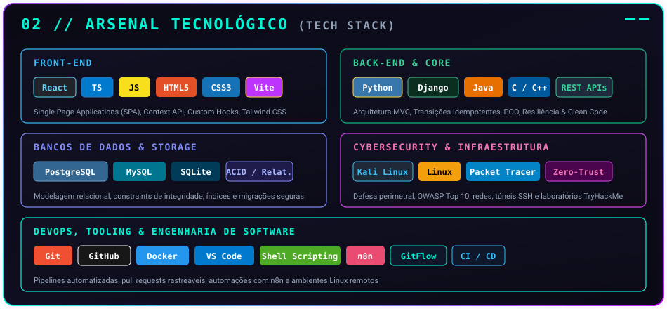
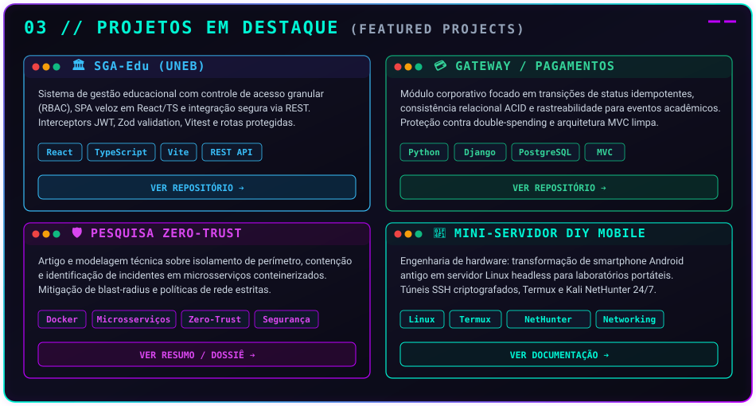
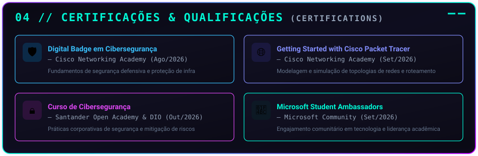
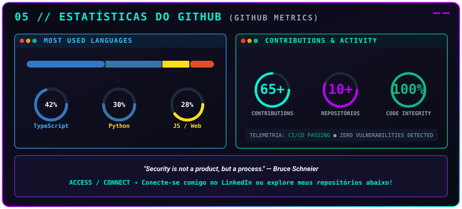
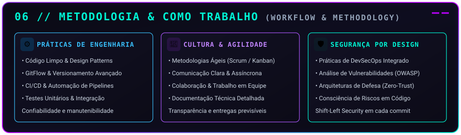
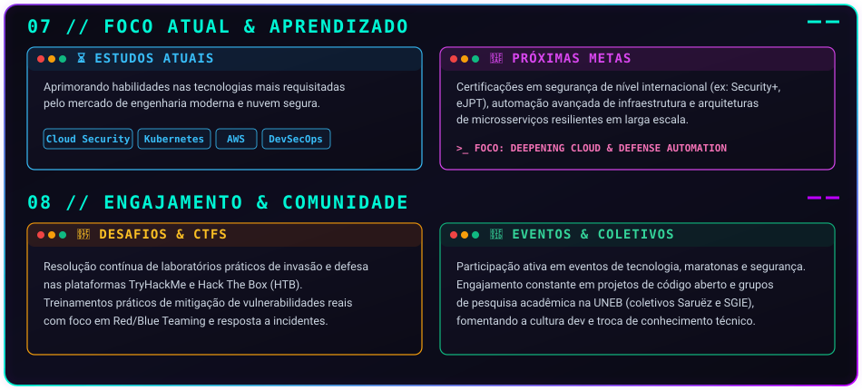

<div align="center">

  <!-- ==================== 00 // HERO BANNER CYBERPUNK HUD ==================== -->
  <a href="https://github.com/DevNaur">
    
  </a>

  <br/><br/>

  <!-- ==================== QUICK ACCESS CYBER HUD BUTTONS ==================== -->
  <p align="center">
    <a href="https://www.linkedin.com/in/caick-santana-dev" target="_blank">
      
    </a>
    &nbsp;&nbsp;
    <a href="mailto:caickruan2@gmail.com" target="_blank">
      
    </a>
    &nbsp;&nbsp;
    <a href="https://tryhackme.com" target="_blank">
      
    </a>
    &nbsp;&nbsp;
    <a href="https://github.com/DevNaur/curriculum-vitae" target="_blank">
      
    </a>
  </p>

  <!-- Dynamic Typing Subtitle -->
  <a href="https://github.com/DevNaur">
    
  </a>

</div>

<br/>

---

### 🖥️ `devnaur@uneb-mainframe:~$ neofetch --profile`

```text
┌──(devnaur㉿uneb-security-node)-[~]
└─$ neofetch --release 2026.4
      /\_/\          USER ........: Caick Ruan (DevNaur)
     ( o.o )         ROLE ........: Software Engineer | Full Stack & Defensive Security
      > ^ <          EDUCATION ...: Bacharelado em Engenharia de Software @ UNEB (4º Semestre)
    /|     |\        LOCATION ....: Bahia, Brasil 🇧🇷
   (_|_ _|_|_)       CORE STACK ..: TypeScript, React, Python, Django, PostgreSQL, Linux
                     SECURITY ....: Zero-Trust Model, Defesa de Aplicações, DevSecOps
                     AFFILIATIONS : Pesquisa Acadêmica UNEB | Coletivos Saruëz & SGIE
                     TARGET ......: Estágio / Desenvolvedor Júnior (Full Stack / DevSecOps)
                     DIAGNOSTIC ..: System Nominal // Shift-Left Security Activated 🟢
```

---

<br/>

<!-- ==================== 01 // SOBRE MIM ==================== -->
<div align="center">
  
</div>

<br/>

---

<br/>

<!-- ==================== 02 // ARSENAL TECNOLÓGICO ==================== -->
<div align="center">
  
</div>

<br/>

---

<br/>

<!-- ==================== 03 // PROJETOS EM DESTAQUE ==================== -->
<div align="center">
  
</div>

<br/>

<!-- Action Bar for Projects -->
<div align="center">

| Projeto em Destaque | Links Rápidos de Código & Documentação |
| :--- | :--- |
| 🏛️ **SGA-Edu (UNEB Campus II)** | [🔗 Explorar Repositório & Arquitetura](https://github.com/PedroUneb2025/Sistema-Escolar) • [📑 Guia de Integração Frontend](https://github.com/PedroUneb2025/Sistema-Escolar/blob/main/INTEGRACAO-FRONTEND.md) |
| 💳 **Gateway / Pagamentos** | [🔗 Ver Módulo Corporativo Django](https://github.com/DevNaur) • *Consistência ACID & Idempotência* |
| 🛡️ **Pesquisa Zero-Trust** | [🔗 Ver Artigo & Modelagem Técnica](https://github.com/DevNaur) • *Contenção de Blast-Radius em Microsserviços* |
| 📱 **Mini-Servidor DIY Mobile** | [🔗 Ver Blueprint & Setup Termux](https://github.com/DevNaur) • *Laboratório Linux Headless Portátil* |

</div>

<br/>

<!-- ==================== INTERACTIVE ACCORDIONS / DOSSIERS ==================== -->
<details>
  <summary><b>📂 [CLIQUE PARA EXPANDIR] Dossiê Técnico: Arquitetura RBAC do SGA-Edu</b></summary>
  <br/>
  <ul>
    <li><b>Autenticação Segura:</b> <code>AuthContext</code> com persistência em storage, emissão de cabeçalho <code>Authorization: Bearer &lt;token&gt;</code> via interceptor Axios centralizado.</li>
    <li><b>Proteção de Rotas:</b> Componente <code>ProtectedRoute</code> validando múltiplos perfis permitidos (<code>admin</code>, <code>secretaria</code>, <code>coordenacao</code>, <code>professor</code>, <code>aluno</code>, <code>financeiro</code>).</li>
    <li><b>Resiliência:</b> Interceptor tratando respostas <code>401 Unauthorized</code> e <code>403 Forbidden</code> com expurgo de sessão e redirecionamento automático.</li>
    <li><b>Qualidade:</b> Validação estrita de contratos de dados em tempo de execução com <b>Zod</b> e suíte de testes com <b>Vitest</b>.</li>
  </ul>
</details>

<details>
  <summary><b>📂 [CLIQUE PARA EXPANDIR] Outros Repositórios & Experimentos Práticos</b></summary>
  <br/>
  <ul>
    <li>💊 <b>FarmaTech:</b> Sistema de controle de estoque e dispensação farmacêutica com modelagem relacional estrita e consultas otimizadas.</li>
    <li>🎟️ <b>Sistema de Gestão de Eventos (Java):</b> Aplicação desenvolvida com Programação Orientada a Objetos rigorosa, separação em camadas e padrões de projeto (POO/Patterns).</li>
    <li>💧 <b>Modelo de Árvore de Decisão para Potabilidade:</b> Pipeline analítico de Machine Learning para classificação de segurança de corpos hídricos.</li>
    <li>🎮 <b>Laboratórios de Lógica & Interatividade Web:</b> Projetos de algoritmos e interação pura em JavaScript ES6+ (Adivinhe o Número, MATEMÁGICA).</li>
  </ul>
</details>

<br/>

---

<br/>

<!-- ==================== 04 // CERTIFICAÇÕES & QUALIFICAÇÕES ==================== -->
<div align="center">
  
</div>

<br/>

---

<br/>

<!-- ==================== 05 // ESTATÍSTICAS DO GITHUB ==================== -->
<div align="center">
  
</div>

<br/>

---

<br/>

<!-- ==================== 06 // METODOLOGIA & COMO TRABALHO ==================== -->
<div align="center">
  
</div>

<br/>

---

<br/>

<!-- ==================== 07 & 08 // FOCO ATUAL & COMUNIDADE ==================== -->
<div align="center">
  
</div>

<br/>

---

<br/>

<!-- ==================== FOOTER & CONNECT ==================== -->
<div align="center">

  

  <br/><br/>

  <p align="center">
    <a href="https://www.linkedin.com/in/caick-santana-dev" target="_blank">
      
    </a>
    &nbsp;&nbsp;&nbsp;&nbsp;
    <a href="mailto:caickruan2@gmail.com" target="_blank">
      
    </a>
  </p>

  <br/>

  <!-- Profile Visitor Counter (Cyber Scan) -->
  

  <br/>

</div>
